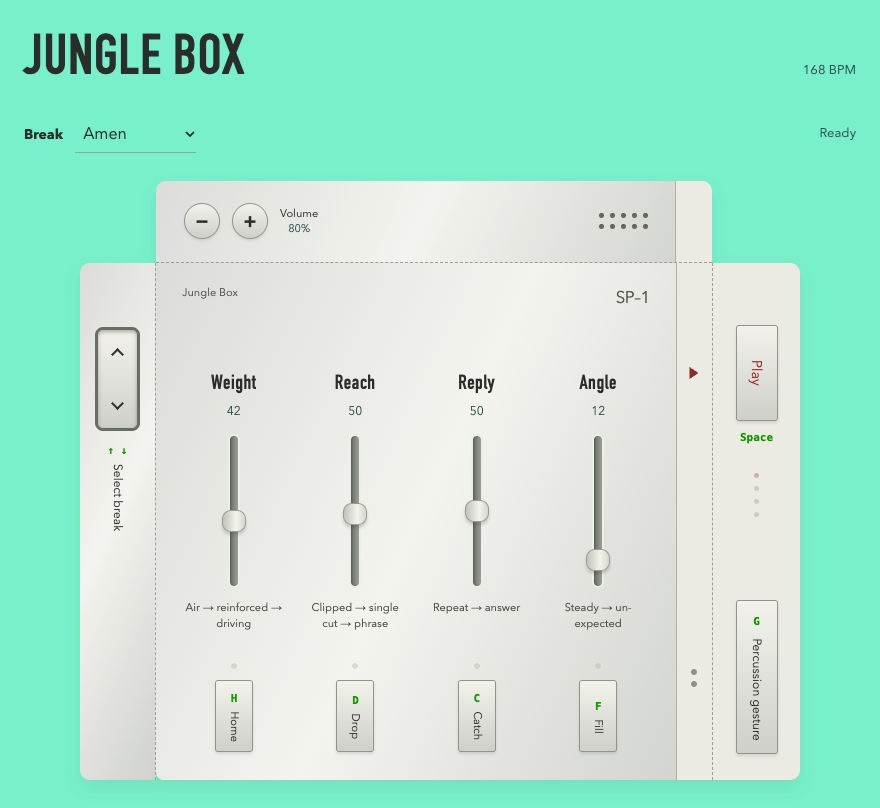

# Jungle Box

A jungle instrument for the SP-1. Generate and reshape breakbeats with four faders and a handful of performance controls.

**[Try the browser demo →](https://canted.github.io/jungle-box/)**

[](https://canted.github.io/jungle-box/)

Jungle Box is being developed for hardware. The browser demo lets you play the current musical design while the SP-1 firmware is still being built and tested. Its unfolded layout brings the device's face and side controls onto one screen.

Pick a break and press Play. The faders shape how the rhythm moves: how hard it pushes, how much of each cut rings out, where the answer falls, and how far the pattern strays from a steady backbeat. Catch a fragment, drop the kick, or throw in a fill as it plays.

## Playing

The demo includes Amen, Think, Hot Pants, Helicopter, Apache and Scorpio. It starts at 168 BPM.

| Fader | What it does |
| --- | --- |
| Weight | Reinforces the groove, adding more activity toward the top of its travel. |
| Reach | Opens short, clipped hits into longer cuts and shuffle tails. |
| Reply | Moves from a repeated call toward regular answers in the second bar. |
| Angle | Changes the placement of the rhythm, from a steady backbeat to offbeat kicks and earlier exchanges. |

Try Angle high with Weight low, then bring Weight up. Hold Drop across both bars and tap Fill before the turnaround.

| Control | Action | Browser key |
| --- | --- | --- |
| Play / Stop | Start or stop the break. | Space |
| Fill | Tap for a run into the bar line. Tap again to cut it short. | F |
| Catch | Hold to repeat a fragment. Reach sets its span. | C |
| Drop | Hold to remove the kick and thin the shuffle. Release for a pickup into the next beat. | D |
| Home | Hold to store the fader positions; tap to recall them. | H |
| Percussion gesture | Hold and move a fader to record percussion. Release to loop it. Tap without moving to clear. | G |

Slow fader sweeps make spaced percussion hits; quick reversals make rolls. The underlying groove keeps playing while you record.

Use ↑ / ↓ to select a break and + / − for volume. Four short, even taps on Home set the tempo between 60 and 240 BPM. You can also hold G and use ↑ / ↓ to adjust tempo; holding an arrow speeds up the adjustment. Arrow keys adjust a focused fader.

## Hardware

The target is the Teenage Engineering SP-1 stem player, using its four sliders and physical buttons. The browser version is the reference for the instrument's musical behavior.

Firmware development is ongoing. Bounded hardware trials have produced Amen playback and an audible response to Reach, but sustained playback and the full set of browser controls are not yet validated on the device. The browser demo does not require an SP-1.

## Run locally

The demo uses plain HTML, CSS and JavaScript with the Web Audio API. There is no build step.

```sh
python3 -m http.server 8000
```

Open [localhost:8000/junglebox.html](http://localhost:8000/junglebox.html) and press Play to start audio.

<details>
<summary>Source and development</summary>

[`junglebox.html`](junglebox.html) and [`instrument.js`](instrument.js) define the browser instrument. The break audio is embedded in [`amen.js`](amen.js) and [`breaks.js`](breaks.js). The [`desktop`](desktop/) directory contains native audio comparison work.

Run the browser engine checks with Node.js:

```sh
for test in tests/*.cjs; do node "$test" || exit 1; done
```

The [Pages workflow](.github/workflows/pages.yml) publishes the browser demo when changes land on `main`.

</details>
